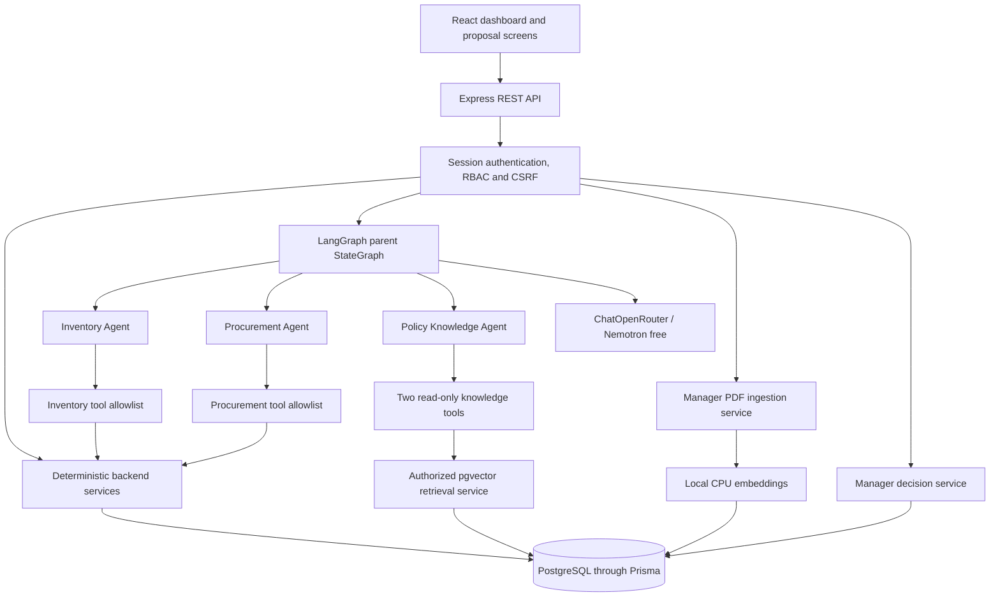
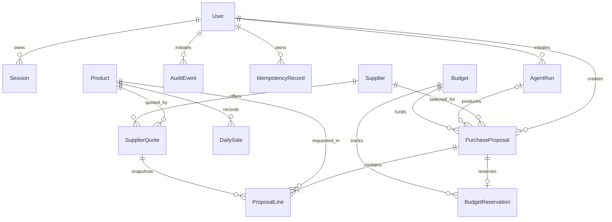
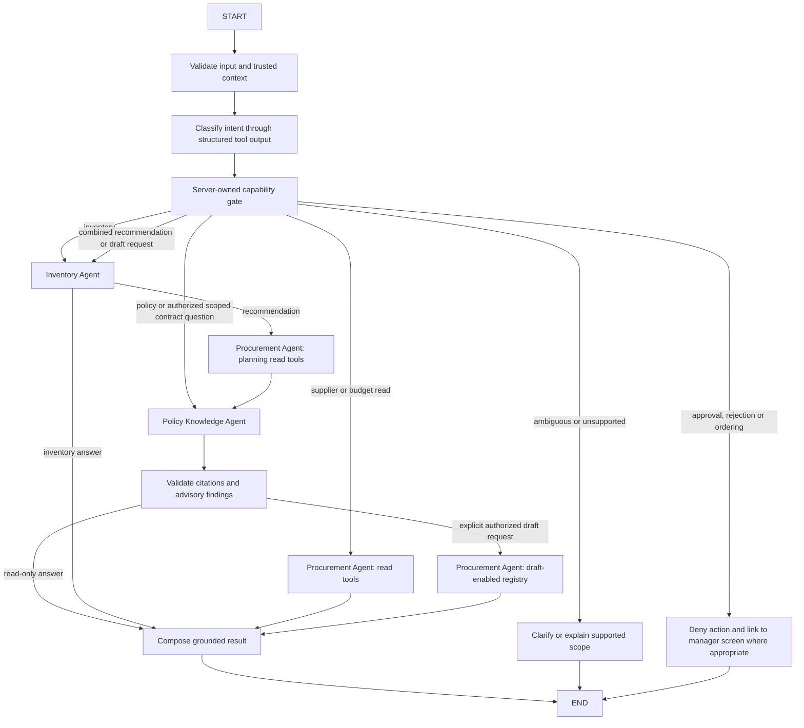
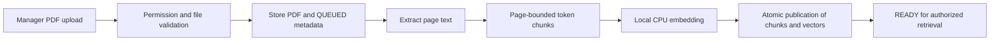

# SupplyPilot AI — MVP Architecture

Status: Days 1–6 are implemented. The explicitly authorized Day 6 dashboard assistant, citations, run recovery and Knowledge UI are connected; see [verification](day6-verification.md). Foundation/authentication, deterministic services, safe manual procurement APIs/UI, backend PDF ingestion, local embeddings/pgvector retrieval and the three-agent LangGraph parent workflow are delivered. The exact free model passed a live classification-to-DRAFT workflow with real cited retrieval on 2026-11-18. Day 6 assistant/knowledge frontend integration is delivered. See [Day 5 verification](day5-verification.md) for migration, data-preservation, evaluation and live-check evidence.

## 1. Scope and architectural decisions

SupplyPilot AI is a supply chain and procurement application for one company. Staff and managers inspect deterministic inventory risks, compare simulated supplier quotes, and create draft purchase proposals. Only authenticated managers approve or reject proposals. Approval reserves budget; it never places an order or increases stock.

| Area | Approved decision |
| --- | --- |
| Frontend | React, Vite, TypeScript strict mode, Tailwind CSS, shadcn/ui |
| Navigation and API state | React Router and TanStack Query |
| Backend | Node.js, Express, TypeScript strict mode |
| Persistence | PostgreSQL, Prisma 7.x, versioned migrations |
| Validation and tests | Zod and Vitest; Supertest for HTTP tests; Playwright browser smoke tests |
| Orchestration | LangGraph JS parent `StateGraph` with Inventory, Procurement and Policy Knowledge agents |
| Model integration | LangChain JS, preferably `ChatOpenRouter` from `@langchain/openrouter` |
| Exact model | `google/gemma-4-31b-it:free` (user-authorized replacement; live check pending); no paid-model fallback |
| Embeddings | Configurable local CPU model through `@huggingface/transformers`; default `Xenova/all-MiniLM-L6-v2`, normalized mean-pooled 384-dimensional vectors; no paid embedding API |
| Knowledge storage | Existing PostgreSQL 17 with pgvector; additive migrations, no separate vector database |
| Knowledge input | Text-based English policy/contract PDFs; manager upload, basic retrieval and page citations |
| Knowledge access | Policies readable by both roles; supplier contracts manager-only and supplier-scoped |
| Identity | Seeded `STAFF` and `MANAGER` accounts with password login |
| Suppliers | Seeded quotes, prices and delivery lead times; no external supplier API |
| Proposals | Multiple product lines, exactly one supplier per proposal |
| Budget | One shared INR 500,000 allocation, represented as `50_000_000` paise |
| Money | Integer paise in backend, database, API, tool results and persisted snapshots |
| Delivery | Local demo with Docker PostgreSQL and a reproducible seed |

Excluded from the MVP: registration, invitations, multi-tenancy, supplier order placement, goods receipt, inventory editing, budget administration, monthly budget rollover, currency conversion, streaming chat, and persistent multi-turn conversation memory.

Also defer OCR, reranking, advanced hybrid search, document editing/version replacement and custom per-document ACL editing. The original end-to-end procurement workflow takes precedence over RAG expansion. A functional dashboard and proposal review flow must exist before Day 6 integration, with a Day 4 acceptance checkpoint. RAG is advisory evidence, never definitive compliance approval; it cannot change the existing business rules below.

Do not remove `:free` or change chat providers/models silently. Local embeddings are separate from chat inference. Full RAG delivery in the remaining five days is a high-risk stretch; use the explicit fallback in section 10 rather than weakening procurement safety or confidentiality.

## 2. System boundaries

- Frontend components format and display authoritative server values. They do not own business calculations or authorization decisions.
- Express handlers validate, authorize, call services, and serialize responses.
- Services own inventory arithmetic, supplier selection, proposal totals, state transitions, reservations and audit writes.
- Prisma owns application database access and migrations. Parameterized SQL through Prisma is permitted for row locks and database constraints.
- Agents receive only explicitly assigned tools. No agent or parent graph receives unrestricted database access, arbitrary code execution, manager session credentials, or decision/order tools. Ingestion is an authenticated manager API capability, not an agent tool.
- The manager decision service is reached through authenticated REST handlers, outside agent tool registries.

## 3. Data model

Use UUID primary keys and UTC timestamps. Date-only sales records represent UTC dates. Preserve proposal and audit history rather than cascading deletion of business records. Accounts and suppliers can be disabled with active flags.

| Model | Important fields and relationships |
| --- | --- |
| `User` | Unique email, password hash, `STAFF`/`MANAGER` role, active flag; sessions, runs, created proposals and decisions |
| `Session` | User FK, unique hashed opaque token, CSRF secret, expiry |
| `Product` | Unique SKU, name, unit, nonnegative integer stock quantity |
| `DailySale` | Product FK, UTC date, nonnegative integer quantity; unique `(productId, date)` |
| `Supplier` | Unique supplier code, name, active flag |
| `SupplierQuote` | Supplier and product FKs, `unitPricePaise`, integer `leadTimeDays`; unique `(supplierId, productId)` |
| `Budget` | Single record, `currency = INR`, `allocatedPaise`, `reservedPaise` |
| `PurchaseProposal` | Supplier, budget and creator FKs, `source = HUMAN/AI`, status, `totalPaise`, reason, optional run FK, decision maker/time/rejection reason |
| `ProposalLine` | Proposal, product and quote FKs, positive quantity, immutable `unitPricePaise` and lead-time snapshots, `lineTotalPaise` |
| `BudgetReservation` | Unique proposal FK, budget FK, `amountPaise`, creation time |
| `AgentRun` | User FK, request key/hash, prompt, requested mode, status, structured result/error and timing |
| `IdempotencyRecord` | User FK, operation, key, request hash and completed response/proposal references for manual draft requests |
| `AuditEvent` | Initiating user, actor kind, action, entity type/ID, request/run ID, timestamp and allowlisted metadata |

The manual draft idempotency record is an implementation detail that preserves the approved retry guarantees. Assistant requests use the unique request key on `AgentRun`.

### Constraints and indexes

- Proposal statuses: `DRAFT`, `APPROVED`, `REJECTED`. Only `DRAFT -> APPROVED` and `DRAFT -> REJECTED` are valid transitions.
- Positive quantities, prices, reservation amounts and lead times; nonnegative stock and sales.
- `0 <= reservedPaise <= allocatedPaise` enforced in PostgreSQL as well as services.
- Unique `(proposalId, productId)` on lines; unique `(agentRunId, supplierId)` on AI proposals; unique reservation per proposal.
- Unique `(userId, requestKey)` on runs and `(userId, operation, key)` on manual idempotency records.
- Index proposal status/creation time, sales product/date, and audit entity/time.
- Validate that a line's quote belongs to its product and the proposal's supplier.
- Proposal lines are immutable. No proposal edit/delete API is included.
- Audit records are append-only through application interfaces. Actor kind distinguishes human and AI actions while retaining the initiating user.

### Monetary representation

Use PostgreSQL `INTEGER` columns mapped to Prisma `Int` and TypeScript numbers validated as safe integers. Every monetary field uses the `Paise` suffix. API and tool schemas expose integer JSON numbers, never rupee floats or decimal money strings.

- INR 500,000 is `50_000_000` paise.
- Line total is `quantity * unitPricePaise`; proposal total is the sum of line totals.
- Available budget is `allocatedPaise - reservedPaise`.
- Bound persisted monetary values to `0..2_147_483_647`, and prices/reservations/totals to positive values where applicable. Check intermediate products and sums before persistence; reject overflow instead of rounding or truncating.
- Audit monetary metadata and cached responses use the same integer representation.
- Rupee conversion occurs only at the display boundary, using Indian currency formatting. No fractional-paise prices, floating-point monetary arithmetic, Decimal/BigInt money fields, or alternate wire representations are introduced.
- Tax, freight, discounts, minimum-order quantities and currency conversion are out of scope and identified in the UI.

## 4. Deterministic inventory and supplier policy

### Sales window and risks

Use the previous 30 completed UTC dates, excluding today. All calculations in one request share a captured `asOf` timestamp. Missing sales dates count as zero.

| Situation | Backend result |
| --- | --- |
| Average daily sales | Total units in the 30-date window divided by 30 |
| Stock = 0 | Days until stockout = 0; `CRITICAL`, including zero-demand products |
| Stock > 0 and average > 0 | Days until stockout = stock / average daily sales |
| Stock > 0 and average = 0 | Days until stockout = `null`; `LOW`; display “No recent demand” |
| Days <= 7 | `CRITICAL` |
| Days > 7 and <= 14 | `HIGH` |
| Days > 14 | `LOW` |

Classify from full precision, then round only for display. Sort critical first, then high, then low, with nearest stockout first within a level and SKU as a stable tie-breaker.

The dashboard KPI is **“At Risk (Next 14 Days)”**, counting `CRITICAL + HIGH`. The separate **“Stockout Within 7 Days”** count includes `CRITICAL` only and can appear in the table summary. Do not label the combined count as a seven-day metric. The 30-day demand observation window and 14-day forward risk horizon are distinct and labeled clearly.

Recommended replenishment quantity:

`max(0, ceil(30 * averageDailySales - currentStock))`

Skip zero recommendations. Zero-demand products require an explicit positive user quantity for purchasing. A zero-stock, zero-demand product still appears as critical.

Drafts and approvals do not change stock or stockout estimates. Show pending replenishment separately. Automatic recommendations exclude products already present in a draft or approved proposal and explain the exclusion. Explicit user requests can specify their intended quantity; retries still use idempotency protection.

### Supplier comparison

1. Resolve requested product IDs and quantities through backend services.
2. For each product with observed demand, prefer quotes whose lead time is strictly less than estimated stockout days.
3. Among those quotes choose lowest price, then shortest lead time, then supplier code.
4. If no quote arrives before stockout, choose shortest lead time, then lowest price, then supplier code; attach a late-delivery warning.
5. For a positive-stock, zero-demand product with an explicit quantity, choose lowest price, then shortest lead time, then supplier code.
6. Use active suppliers only. Reject unknown products, invalid quantities, or missing valid quotes with a clarification/error before writing drafts.

Group chosen lines by supplier. One explicit replenishment request can produce multiple drafts, but all supplier groups are created atomically with their lines and audit events. Persist price and lead-time snapshots; subsequent approval uses these fixed terms rather than silently repricing the proposal.

### Budget warnings

Drafts may exceed available budget. Return `overBudget`, `shortfallPaise`, and a timestamped budget snapshot; display warnings in assistant results, proposal lists and details. For a batch of drafts, also show the combined request cost and shortfall because individually affordable drafts can exceed funds together.

Draft creation never reserves funds. Available budget is informational until approval. Always re-read it during the approval transaction; a prior warning or UI-disabled button is not the enforcement mechanism.

## 5. Authentication, authorization and decision transactions

### Authentication and security

- Seed staff and manager credentials from environment configuration; hash passwords with Argon2id.
- Generate random opaque session tokens, store hashes in PostgreSQL, and use an eight-hour expiry.
- Cookies: `HttpOnly`, `SameSite=Lax`, and `Secure` outside local HTTP development.
- Use the Vite same-origin API proxy locally. Require CSRF tokens and origin validation for authenticated mutations.
- Resolve active user and current role server-side on each authenticated request. Client role fields and model claims are never authoritative.
- Validate requests, environment configuration, tool arguments and structured model results with Zod. Reject unknown security-sensitive fields.
- Apply login/assistant rate limits, request size limits, security headers and safe error responses with request IDs.
- Do not expose server secrets, OpenRouter keys, tokens or internal prompts in the frontend or ordinary logs.
- Treat user messages, supplier descriptions and model output as untrusted data. Do not execute HTML, code or model-supplied internal URLs.

| Capability | Staff | Manager | AI agent |
| --- | --- | --- | --- |
| Read inventory, suppliers, budget and proposals | Yes | Yes | Assigned read tools only |
| Request/create draft | Yes | Yes | Procurement tool with explicit draft capability |
| Approve/reject | No | Yes, through authenticated decision endpoint | Never |
| Reserve funds | No direct access | Only as part of approval | Never |
| Place supplier order | Out of scope | Out of scope | Never |
| Read/search policies | Yes | Yes | Policy Knowledge policy tool only |
| Read/search supplier contracts | No | Yes, relevant supplier scope | Policy Knowledge contract tool, manager context only |
| Upload/retry/archive knowledge | No | Yes | Never |

Contract confidentiality applies to metadata, source text and derived findings across retrieval, agent state, handoffs, responses, owned run results, proposals, citation downloads and audit metadata. Do not copy restricted findings into staff-visible proposal reasons or shared summaries. A staff recommendation may indicate that contract review is unavailable for its role without revealing whether a particular contract exists. Apply access checks to every source opening, not just the initial retrieval.

### Approval

Authorize the manager before invoking the decision service. Use a short Prisma interactive transaction. Lock the shared budget row first, then the proposal row, with parameterized `SELECT ... FOR UPDATE`. All decision paths use the same lock order.

1. Re-read status under lock. An identical repeated decision returns the existing result; a conflicting terminal decision returns `409`.
2. Require `DRAFT`, recalculate total from persisted lines, and validate the budget currency and immutable snapshot integrity.
3. Require available funds >= proposal total. Insufficient funds returns `409 INSUFFICIENT_BUDGET` and leaves every record unchanged.
4. Increment `reservedPaise` using a conditional update that cannot exceed `allocatedPaise`.
5. Insert the unique `BudgetReservation` and set status, manager ID and decision timestamp.
6. Insert the approval audit event in the same transaction.

If any step fails, roll back every write. Apply bounded retries for deadlocks/transaction conflicts. Never perform a model call or supplier request inside the transaction.

Rejection uses a required nonempty reason, locks consistently, and atomically writes `REJECTED`, manager identity/time, and audit event. It creates no reservation. Approved/rejected proposals are terminal in this MVP; cancellation and reservation release are out of scope.

Concurrent approval requests must create exactly one reservation. Concurrent approvals for different proposals must never overspend the shared budget. Concurrent approval/rejection must yield exactly one final decision.

Audit coverage includes successful draft creation, approvals, rejections, authentication/security events, and denied tool actions. Business mutation audit events commit with the mutation. Store allowlisted metadata rather than raw prompts, credentials or supplier documents. The run record holds the prompt for owned-run recovery; it is not ordinary log output.

## 6. REST interface

Prefix endpoints with `/api`. Shared Zod schemas live in `packages/contracts`. Return money only in integer paise, dates/times as ISO values, and nullable days for no recent demand.

| Method and path | Purpose | Access |
| --- | --- | --- |
| `POST /auth/login` | Validate credentials, create session, return user/CSRF token | Public, rate limited |
| `GET /auth/me` | Current user and CSRF token | Authenticated |
| `POST /auth/logout` | Revoke session | Authenticated |
| `GET /dashboard` | Four KPIs, status counts, budget summary, latest five proposals and `asOf` | Staff/manager |
| `GET /inventory/risks` | Risk rows, SKU/name search, risk filter, pagination | Staff/manager |
| `GET /products/:id/sales` | Previous 30 daily sales values | Staff/manager |
| `GET /products/:id/quotes` | Supplier comparison and recommendation | Staff/manager |
| `GET /budget` | `allocatedPaise`, `reservedPaise`, `availablePaise`, currency | Staff/manager |
| `GET /proposals` | Paginated proposals with status filter | Staff/manager |
| `GET /proposals/:id` | Immutable lines, warnings, comparison, budget impact and audit timeline | Staff/manager |
| `POST /proposals` | Manual draft creation using the shared deterministic service | Staff/manager |
| `POST /proposals/:id/approve` | Approve and reserve atomically | Manager only |
| `POST /proposals/:id/reject` | Reject with reason | Manager only |
| `POST /assistant/runs` | Execute one bounded assistant request | Staff/manager |
| `GET /assistant/runs/:id` | Recover owned run/result and draft links | Run owner only |
| `GET /audit-events` | Paginated audit history | Manager only |
| `GET /health` | Process/database readiness without secrets | Public |
| `POST /knowledge/documents` | Multipart PDF upload; returns `202` with document/status | Manager only |
| `GET /knowledge/documents` | Authorized paginated listing | Staff policies; manager policies/contracts |
| `GET /knowledge/documents/:id` | Authorized metadata/status | By document type |
| `GET /knowledge/documents/:id/file` | Authorized original PDF for citation review | By document type |
| `POST /knowledge/documents/:id/retry` | Retry failed ingestion | Manager only |
| `POST /knowledge/documents/:id/archive` | Exclude document from future retrieval | Manager only |
| `POST /knowledge/search` | Strict query/type/supplier retrieval preview | By document type and supplier scope |

Important contracts:

- Dashboard: `totalProducts`, `atRiskNext14Days`, `stockoutWithin7Days`, `pendingProposals`, `availableBudgetPaise`, `currency`, proposal status counts, budget summary, recent proposals, `asOf`. Pending means `DRAFT`.
- Risk row: product ID/SKU/name, stock, average daily sales, nullable estimated days until stockout, risk level, pending replenishment indicator.
- Assistant request: `{ message, mode: READ_ONLY | CREATE_DRAFT }` and `Idempotency-Key` header. Identity and capabilities are not request fields.
- Assistant response: run ID/status, grounded answer, structured findings, warnings and created proposal IDs.
- Manual draft request: product IDs, optional explicit positive integer quantities and reason, plus `Idempotency-Key`. Backend selects supplier groups and calculates totals. The result can contain multiple drafts.
- Same user/key/input returns the prior run or result; same key with different input returns `409`. Canonical request hashes cover mode, products, quantities and other effective input.
- Pagination uses page/page-size, with a maximum page size of 100.
- Errors: `{ error: { code, message, requestId, fieldErrors? } }`. Distinguish `401`, `403`, `404`, validation errors, `409`, and `503` model unavailability.

## 7. LangGraph workflow and agent state

### Model availability and integration gate

On 2026-11-15, OpenRouter's public model catalog listed the exact ID `nvidia/nemotron-3.5-lightning:free` with prompt/completion pricing of zero and supported parameters including `tools` and `tool_choice`. It did not list `response_format` or native structured outputs for this free variant. This verifies advertised capabilities, not an authenticated end-to-end inference call.

- Use `ChatOpenRouter` from `@langchain/openrouter` with LangChain tool schemas and `bindTools`.
- Use function-calling-based structured classification with Zod validation; do not rely on native JSON-schema response formatting or assume strict output enforcement by this model.
- Pin the exact free model. Do not supply a paid fallback model list, automatic model routing, or silently strip `:free`.
- Before implementing agent workflows, recheck the catalog and run a small authenticated tool-call/classification smoke test through the chosen integration.
- If the free ID disappears, has no suitable endpoint, loses tool support, or the smoke test fails, report the issue before agent implementation. Do not substitute a paid model. The manual workflow remains available.
- Handle rate limits and transient failures with bounded retries. Fail closed with an explicit unavailable message; never retry writes blindly.
- Use only synthetic seeded business data for this local demo. The free endpoint's published data-use terms are relevant before any future production-data use.

### Parent graph

Classification enum: inventory query, procurement query, combined purchase recommendation, policy query, supplier-contract query, draft request, forbidden action, clarification, unsupported request. An unknown supplier scope for a contract question requires clarification; unauthorized contract access is denied without disclosing restricted metadata.

Classification selects a route; it does not authorize actions. Draft execution requires both explicit `CREATE_DRAFT` mode selected by the user and validated draft intent. The default is `READ_ONLY`. Ambiguity fails closed. No route grants approval, rejection or ordering capabilities.

The parent orchestrator mediates communication through validated typed state and explicit transitions, not direct agent-to-agent calls. Inventory findings feed deterministic procurement planning; planning produces supplier scope for knowledge retrieval. The parent validates citations before presenting the recommendation or enabling the Procurement Agent's draft phase. Plain supplier/budget questions do not require RAG.

Policy findings can identify supporting clauses, potential conflicts, insufficient evidence or retrieval unavailability. They never certify compliance, rerank suppliers, change quantities/prices, grant approval or introduce a new policy-acknowledgement gate. Missing evidence/unavailability is visible but does not block an otherwise authorized explicit draft. If RAG is disabled under the fallback, preserve the original graph path and state clearly that no policy review occurred.

### State and immutable context

| Graph state | Fields |
| --- | --- |
| Identity | Run ID, request ID, captured server timestamp |
| Input | Message and requested mode |
| Routing | Validated intent, selected route, clarification/denial reason |
| Working data | Inventory findings, product IDs, quantities, quote comparisons and budget snapshot |
| Knowledge review | Query/type/supplier scope, retrieval status, authorized chunk references, server-validated citations and advisory findings |
| Progress | Active agent, bounded message history, tool-call count, deadline |
| Output | Created proposal IDs, structured answer, warnings and sanitized errors |

Server-owned runtime context contains authenticated user/role, immutable capabilities, allowed registries, service dependencies and deadline. Do not merge model output into these fields or permit user-supplied graph state. Tool handlers close over trusted context rather than accepting identity or privilege parameters from the model.

Pass only evidence authorized for the current role and stage. Keep contract findings restricted in manager-owned runs; do not forward whole transcripts or restricted findings to staff-visible proposal fields. Recheck current permissions when recovering a run or opening a citation, including if an account's role changed. No general audit/log payload should contain contract excerpts or derived confidential findings.

### Assigned tools

| Agent | Tool | Contract |
| --- | --- | --- |
| Inventory | `getStockLevels` | Optional product IDs; returns product identity and stock |
| Inventory | `getSalesHistory` | Product IDs; returns fixed 30-day series and backend average |
| Inventory | `getInventoryRisks` | Optional product IDs/risk filter; returns calculated risks and recommended quantities |
| Procurement | `getSupplierQuotes` | Product IDs and optional quantities; returns prices in paise, lead times, deterministic rankings and warnings |
| Procurement | `getAvailableBudget` | No model-supplied budget ID; returns shared budget in paise |
| Procurement | `createPurchaseProposal` | Product IDs, optional quantities and reason; creates supplier-grouped `DRAFT` proposals only |
| Policy Knowledge | `searchProcurementPolicies` | Validated query; server forces policy type and current user's access |
| Policy Knowledge | `searchSupplierContracts` | Validated query and required supplier ID; manager-only, server forces contract type and supplier scope |

Use separate tool registries and execution nodes for all three agents. Omit the write tool in read-only procurement mode, and also enforce the draft capability inside its handler. The Policy Knowledge Agent is read-only and cannot upload documents or write proposals. Deny unknown or cross-agent tool names before invocation. All tool arguments use strict Zod schemas.

The parent passes structured inventory findings into the procurement step. Procurement services independently revalidate products, demand, quantities, quotes and budget snapshots; the Procurement Agent does not receive Inventory Agent tools. Model-generated prices, totals and status fields are never accepted as authority.

### Execution and recovery

- Bound one request to 60 seconds and 12 total tool calls; allow one structured-output repair attempt within the deadline.
- Persist `AgentRun` metadata/result, using running/completed/failed status and explicit errors. No durable conversational checkpointer is required.
- Reusing a request key returns the existing run or result; a pending run is not executed a second time.
- Create all draft groups, audit events and proposal/run links in one transaction. A unique run/supplier constraint prevents repeated tool calls from duplicating drafts.
- Final text is a presentation step. If it fails after commit, return/recover the persisted draft IDs and structured findings rather than claiming that nothing was created.
- Reconcile expired interrupted runs from persisted proposals. Mark failed/interrupted runs explicitly without replaying completed writes. A restarted local server can reconcile abandoned running records.
- Redact secrets from errors and logs. Track request/run IDs, intent, permitted tool names, latency, token usage when provided, denied actions and transaction conflicts.

## 8. Frontend information architecture

| Route | Page and main behavior |
| --- | --- |
| `/login` | Password form, generic credential error, session redirect |
| `/` | Dashboard with four KPI cards, risk table, procurement overview, recent proposals and assistant |
| `/proposals` | Status-filtered, paginated list and manual draft dialog |
| `/proposals/:id` | Proposal details, supplier comparison, immutable totals, budget warning, decision and audit timeline |
| `/knowledge` | Authorized document list, manager upload/type/supplier controls and ingestion status/retry/archive; upload UI may be deferred under the approved fallback |

Dashboard components:

- `KpiCards`: Total Products, At Risk (Next 14 Days), Pending Proposals, Available Budget.
- `InventoryRiskTable`: SKU/name, stock, average daily sales, estimated days until stockout, risk badge and replenishment indicator. Show the separate Stockout Within 7 Days summary where useful.
- `ProcurementOverview`: status counts plus allocated/reserved/available budget.
- `RecentProposals`: latest five by creation time with stable ID tie-breaker and detail links.
- `AssistantPanel`: local transcript, message input, progress, recovery errors, grounded results and proposal links. Default to read-only and label the explicit mode control “Allow draft proposals.”
- Assistant knowledge answers show page citations, advisory wording, potential conflicts and missing/unavailable evidence. Source links recheck authorization; staff never see contract metadata or derived findings.

Proposal details expose approve/reject controls only to managers, with confirmation dialogs and a required rejection reason. Staff see read-only decision information. Insufficient funds disables approval as a usability aid, while the server remains authoritative. Always show that approval reserves budget only.

Invalidate dashboard, proposals, inventory and budget queries after draft creation or a decision. Refresh stale data on conflicts. Provide accessible controls and responsive loading, empty, error and retry states. Render assistant text safely; do not inject arbitrary HTML.

The manual dashboard, proposal list/details, draft creation and manager review must be functional at the Day 4 checkpoint, before Day 6 integration. If delayed, completion takes precedence over RAG expansion on Day 5. Day 7 is freeze, repair and rehearsal, not first delivery of core screens.

## 9. Validation and references

Required verification covers risk boundaries, zero/missing demand, integer monetary overflow, supplier ranking, over-budget drafts, insufficient-funds approval, role/CSRF checks, duplicate requests, concurrent decisions, atomic rollback, tool isolation and recovery after model failures. Use real PostgreSQL for transaction tests and mocked model calls in normal automated tests. The live free-model smoke test is separate and opt-in.

Preserve the completed Day 1–2 checks documented in [day1-verification.md](day1-verification.md) and [day2-verification.md](day2-verification.md). Add the data-preservation, RAG and confidentiality acceptance checks in section 10. No compatibility or live model success is implied by approving this architecture.

Documentation sources checked during planning on 2026-11-15:

- [LangGraph JS graph API](https://docs.langchain.com/oss/javascript/langgraph/graph-api)
- [LangChain ChatOpenRouter integration](https://docs.langchain.com/oss/javascript/integrations/chat/openrouter)
- [OpenRouter public model catalog](https://openrouter.ai/api/v1/models)
- [Nemotron 3.5 Lightning free model](https://openrouter.ai/nvidia/nemotron-3.5-lightning:free)
- [OpenRouter tool calling](https://openrouter.ai/docs/guides/features/tool-calling)
- [Prisma 7 transactions](https://www.prisma.io/docs/orm/v7/prisma-client/queries/transactions)

Additional references consulted for the approved RAG plan:

- [Transformers.js Node inference](https://huggingface.co/docs/transformers.js/tutorials/node)
- [MiniLM Transformers.js model and 384-dimensional usage](https://huggingface.co/Xenova/all-MiniLM-L6-v2)
- [MiniLM model limits](https://huggingface.co/sentence-transformers/all-MiniLM-L6-v2)
- [PDF.js document/page access and Node examples](https://mozilla.github.io/pdf.js/examples/)
- [pgvector installation and vector search](https://github.com/pgvector/pgvector)
- [Prisma unsupported extension types and parameterized SQL](https://www.prisma.io/docs/postgres/database/postgres-extensions)

See [implementation-plan.md](implementation-plan.md) for repository layout, daily milestones, test scenarios and readiness criteria.

## 10. PDF ingestion and RAG

### Hard prerequisite and non-destructive rollout

Do not implement PDF ingestion until both checks pass on the actual development runtime and their results are recorded:

1. Local embedding model loads, produces finite nonzero normalized vectors of the expected dimension, and works from its cache. Record model/revision, runtime and configuration.
2. A pgvector-enabled image works against a copy of the existing PostgreSQL data volume, preserves existing business records/balances, and passes vector insert/cosine-search round trips. Merely finding an image or package is not a pass.

Time-box Day 3 feasibility checks to two hours. If blocked, report the issue and continue independent procurement work; ingestion remains blocked. Full chat-agent implementation separately requires the exact free model's live tool-calling smoke test with configured credentials.

The existing image is `postgres:17-alpine`. Build a derived image from the same pinned PostgreSQL 17 Alpine base and a pinned compatible pgvector release; do not automatically switch operating systems or PostgreSQL major versions. Record tested image/extension versions before use.

Before future rollout, back up PostgreSQL, record existing business counts/records and budget/reservation values, and test the derived image on a copied volume. Keep the existing `postgres_data` volume, mount and database configuration. Then deploy a new forward-only additive migration with `CREATE EXTENSION IF NOT EXISTS vector` and the knowledge tables below. The extension must already be available in the server image. Verify data and Day 1–2 tests afterward.

Never reset migrations, regenerate the database, delete the volume or rerun the business seed for this change. Knowledge fixtures use a separate ingestion command. This is planned migration work, not authorization to execute it during documentation updates.

### Knowledge data model

All four models below were added by the forward-only Day 5 migration. Existing business tables and rules remain intact.

| Model | Fields and relationships |
| --- | --- |
| `KnowledgeDocument` | UUID; type `PROCUREMENT_POLICY`/`SUPPLIER_CONTRACT`; supplier FK for contracts only; uploader User FK; title/original filename; content checksum; original PDF bytes (`bytea`); page count; ingestion status/sanitized error; timestamps |
| `DocumentChunk` | UUID; document FK; chunk order; one-based original page number; normalized supporting text and offsets within normalized page text; unique document/chunk order |
| `EmbeddingProfile` | Immutable provider/model ID, pinned revision, dimensions, pooling, normalization and chunking configuration identifying one compatible vector space |
| `ChunkEmbedding` | Chunk/profile FKs; dimensions and pgvector `vector`; unique chunk/profile pair; database check that vector dimensions equal the stored dimension |

Policies must not have a supplier association; contracts require an existing validated supplier. Fixed type-based permissions replace a custom ACL editor in Week 1. A document's type/supplier is not edited after upload.

Keep the vector column without a fixed dimension declaration, validate profile dimensions and finite nonzero vectors in services, and filter searches by the matching immutable profile. Prisma 7 uses `Unsupported("vector")`; perform extension-specific inserts/searches through parameterized Prisma SQL. Select metadata/text/similarity rather than attempting to deserialize unsupported vector columns through ordinary Prisma result objects. No Prisma major upgrade or separate vector database is required.

### Upload and indexing pipeline

- Accept one text-based English PDF per request, at most 10 MiB and 50 pages. Require manager authentication, origin and CSRF validation before multipart parsing; validate `.pdf` extension, declared MIME, signature and actual PDF parser recognition.
- Use PDF.js through `pdfjs-dist` for page-by-page text extraction; preserve original one-based page numbers. Reject encrypted, malformed or entirely image-only documents, skip blank pages and report sanitized errors. No OCR or table/layout reconstruction is promised.
- Store original PDFs/metadata in PostgreSQL; filenames are display data, not filesystem paths. Duplicate bytes/type/supplier uploads return the existing document.
- Split within each page into approximately 180 model tokens with 30-token overlap, retaining supporting text and normalized page offsets. Do not cross page boundaries. Keep input below the chosen model's token limit; never silently truncate oversized chunks.
- Use one background ingestion worker and persisted states `QUEUED`, `PROCESSING`, `READY`, `FAILED`, `ARCHIVED`. Extraction/embedding occurs outside database transactions. Publish complete chunks, embeddings and READY status atomically. Partial/failed/archived documents are never searchable.
- Failed records support explicit retry without duplicate chunks. Mark interrupted PROCESSING records failed on startup so they can be retried. Archiving excludes a document from subsequent retrieval and citation access; do not let cached/run-recovered output re-expose archived or newly unauthorized evidence.

### Configurable local embeddings

Default to backend CPU inference with `@huggingface/transformers` and `Xenova/all-MiniLM-L6-v2`, using mean pooling and normalization for 384-dimensional embeddings. No paid embedding API, Python service or GPU is required. Initial weights need network download; then use the local cache. Actual Node/native-runtime compatibility is a prerequisite test, not an assumed success.

Configuration includes embedding model ID, pinned revision, cache directory and retrieval threshold. Persist model/revision/dimension/pooling/chunking in an immutable embedding profile. A model/configuration change requires re-embedding knowledge documents under a matching profile; never compare vectors from different profiles or pad/truncate dimensions. Re-embedding must not alter business data.

Embeddings are separate from chat. Continue using `@langchain/openrouter` with `google/gemma-4-31b-it:free` for chat/tool calls, with no paid fallback. Use synthetic documents for the Week 1 demo.

### Retrieval, citations and insufficient evidence

Use exact cosine similarity search in pgvector for the small Week 1 corpus. Defer approximate indexes, reranking and advanced hybrid search.

Enforce filters in parameterized SQL before ranking/top-k: document READY status, authorized type, required validated supplier ID for contracts, and matching embedding profile. Tool handlers force their assigned document type; model-supplied filters cannot widen access. Contract searches are manager-only and never search across suppliers implicitly.

Return up to five results. Start `RAG_MIN_SIMILARITY` at `0.45`, calibrate it using development fixtures at the first working retrieval checkpoint (Day 4 if feasible, otherwise Day 5 after core UI acceptance), and record the selected setting before evaluation. Similarity is relevance, not factual confidence or compliance approval.

Build citations on the server from the current authorized retrieved records:

`{ documentId, chunkId, pageNumber, supportingText }`

Verify that every cited chunk belongs to the current result set, page number matches source metadata, and supporting text appears in the chunk. The model cannot invent IDs, pages or quotations. Recheck role, supplier scope and document availability when opening a citation/PDF or recovering a stored answer; suppress restricted or archived findings rather than replaying stale content.

Use explicit outcomes:

- `EVIDENCE_FOUND`: relevant passages were retrieved; findings remain advisory.
- `INSUFFICIENT_EVIDENCE`: no authorized result met the relevance requirement; do not invent a clause or compliance verdict.
- `UNAVAILABLE`: retrieval/model/parser/database processing failed; do not disguise a failure as a completed policy review.

Knowledge search request: strict query, type and supplier ID where applicable. Responses carry outcome, authorized evidence/citations and sanitized warnings. Mutating knowledge endpoints use existing session/RBAC/origin/CSRF protections. Authorized search preview uses the same permission-filtered service as agent tools.

### Priority gates and fallback

The manual end-to-end procurement workflow is the highest priority. Acceptance by Day 4 requires functional four-card dashboard, risk table, procurement overview/latest five, manual drafts and proposal review/manager decisions, independently of AI. If this slips, finish core UI before RAG expansion on Day 5.

Full RAG plus three agents in five remaining solo days is a high-risk stretch. Protect safety, access control, citation validity and tests before styling/polish. The fallback is explicit:

1. If live upload/its UI is unreliable at the end of Day 4, use a small synthetic corpus pre-ingested by an operator command through the same pipeline, after the hard compatibility gate. This retains genuine embeddings/retrieval/citations but live upload is deferred, not complete.
2. If retrieval, confidentiality or citations remain unsafe by the end of Day 5, disable RAG and Policy Knowledge, label review unavailable and preserve the original procurement demonstration.
3. If the free chat model/key is unavailable, retain manual procurement and working direct retrieval preview. No paid substitution or mocked live-agent claims.

Day 6 integrates/evaluates already functional procurement screens; Day 7 freezes features and repairs/rehearses. See the implementation plan for daily gates.

### RAG acceptance

- Existing functionality and business records/balances survive the additive migration and all Day 1–2 tests pass.
- Ingestion tests cover valid, oversized, spoofed, malformed, encrypted and image-only PDFs, blank pages, page numbering, duplicate upload, retry and interruption.
- A synthetic labeled corpus includes at least ten answerable questions and five unanswerable questions. An expected supporting source appears in the top five for at least 80% of answerable cases; unanswerable fixtures abstain.
- Every returned citation resolves to authorized source text/page; fabricated citations are rejected.
- Tests cover staff/manager and supplier isolation, archived/failed documents, profile/dimension mismatch, unavailable models and role changes on stored-result recovery.
- Prompt-injection fixtures cannot change roles/tools/filters, alter deterministic purchasing rules or trigger approvals/orders. Confidentiality tests inspect graph handoffs, responses, proposal fields and audit/log metadata, not retrieval alone.
- Keep deterministic mocked unit tests distinct from real PostgreSQL/pgvector/local-model evaluation and credential-dependent live chat checks. Record fallback/deferred scope honestly.

## Day 4 implemented frontend checkpoint

The manual procurement UI is implemented independently of AI: dashboard, inventory filtering/pagination, latest five proposals, status-filtered proposal list, shared draft dialog and proposal detail/review screens. Staff and managers create drafts; managers decide, including their own drafts. Product identities and saved quantities/prices/lead times are explicit on details. Current supplier comparison is fetched only when requested and cannot mutate snapshots. The assistant is disabled and marked unavailable.

TanStack Query business keys include the current user ID. Shared Zod schemas validate read/write responses, including the supplier comparison contract. Requests send HttpOnly cookies through the Vite `/api` proxy; mutations send the current CSRF token. Authentication expiry cancels protected reads, clears business caches and redirects through the authenticated shell. Role/CSRF failures refresh the session; decision conflicts refresh business queries. Successful creation/decisions invalidate dashboard, inventory, proposal and budget-dependent data. Monetary conversion is display-only; calculations remain in existing backend services.

Before creation, the shared dialog persists the validated body and its idempotency key in user-scoped sessionStorage. An uncertain response locks editing and offers explicit retry of that exact request. Recovery survives reloads within the tab; closing the tab/clearing storage ends local recovery. No credentials or CSRF tokens are stored. The original response may describe a draft that has since been decided; recovered links open its current state. The server transaction/idempotency rules remain unchanged.

Day 4 changes add frontend components, shared response types and test tooling; there are no changes to business services, database schema, migrations, seed behavior or the live PostgreSQL image/volume. Playwright provisions only an isolated test database through the existing safe harness. See [Day 4 verification](day4-verification.md). At the Day 4 checkpoint, upload/RAG/agents were still planned. Their subsequent Day 5 implementation and live verification are recorded below.

## Day 5 implemented backend checkpoint

The parent `StateGraph` now classifies through a Zod-validated function call and routes Inventory, Procurement and Policy Knowledge stages. Checkpoint state contains run/request IDs, captured time, validated input/intent, inventory/product/supplier handoffs, authorized knowledge results, progress/deadline and structured output. Identity/role/session/capabilities stay in server-owned closures. Each specialist uses one bounded model tool-call turn. A parent-owned output formatter then reads retrieved evidence and may return only advisory labels plus validated source indices; it has no business tools or write capabilities. There is no redundant unconstrained final generation. Manager recommendation reviews may use deterministic follow-up calls to the same Knowledge Agent's supplier-scoped read tool, within the shared call/deadline budget. Unknown/cross-agent tools and invalid batch arguments are rejected before any execution.

Default mode is READ_ONLY. Draft execution requires CREATE_DRAFT plus DRAFT_REQUEST intent and an active owned run, unchanged role, live session and unexpired deadline inside the write transaction. User quantities override model arguments; other model-invented quantities are rejected. Explicit selected-product batches must retain their full selected scope. The shared deterministic creation service saves only AI DRAFTs with run links, fixed nonconfidential reasons and supplier-grouped atomic writes. Manual creation and manager decisions retain their previous checks. No approval/rejection/order tool exists.

One request has a hard 60-second deadline and at most 12 tool calls, including classification and deterministic knowledge follow-ups. Durable owned runs support same-key recovery, mismatched-input conflicts and interrupted-run reconciliation. If final run publication fails after drafts commit, recovery returns their links. SDK errors are sanitized; audit metadata records only IDs, safe codes/stages, tool count, duration and token counts when provided. Native JSON-schema response formatting is not assumed. Chat stays on the exact free ID with zero prompt/completion/request price limits at the provider selector.

The PostgreSQL service now builds pgvector 0.8.7 on the same pinned PostgreSQL 17.12 Alpine base. A private custom-format backup and copied-volume migration test preceded rollout; `postgres_data` was retained. The migration adds knowledge tables and nullable run metadata, without rewriting business records. The Prisma schema matches the applied database. Profiles are immutable; vector dimension/profile checks are database-enforced. Queries materialize authorized READY/type/supplier/profile candidates before cosine ranking, preventing both authorization leakage and incompatible-dimension comparisons.

Authenticated manager multipart upload is available through the API. One database advisory lease serializes API/operator ingestion without holding a transaction during extraction/embedding. Stale PROCESSING records are failed only while that lease is owned. Complete page-bounded chunks and vectors publish atomically; malformed/encrypted/image-only/oversized PDFs fail safely. Source/citation opening and owned-run recovery recheck current permissions and archive state. Disabling RAG suppresses search and citation replay while retaining manual procurement.

The local cached profile is pinned to MiniLM revision `751bff37182d3f1213fa05d7196b954e230abad9`, CPU q8, mean pooling, normalized 384 dimensions, 180-token chunks/30-token overlap. A model/profile change requires its compatibility check, API restart and explicit operator re-embedding of knowledge documents. Re-embedding changes no business records. English text PDFs are the supported Week 1 content; there is no OCR, reranking, hybrid search or production document corpus.

`POST /api/knowledge/citations/resolve` additionally validates a supplied citation against its current authorized chunk/page/text. Contract source endpoints require the matching supplierId query parameter. `POST /api/assistant/runs` accepts message, mode, optional selected product items/quantities and optional supplierId plus Idempotency-Key; `GET /api/assistant/runs/:id` recovers only the owner's result. Shared Zod response types carry status, intent, static grounded answer, structured tool data, advisory citations, warnings and committed proposal IDs. Authorized knowledge results also include type/supplier scope for citation links; combined reviews use actual backend-selected suppliers. Day 6 connects these APIs to dashboard chat and the knowledge upload/status UI. A manager-only `GET /api/knowledge/suppliers` directory returns supplier id/code/name for explicit scope selectors.

The synthetic-corpus operator fallback is delivered through the actual PDF/embedding/indexing pipeline. One clearly labeled ten-page synthetic policy is READY in the application database; no real contracts were fabricated or uploaded there. Live PDF upload is implemented at the backend, with its browser UI delivered in Day 6. See the verification record for actual tests, initial live-run failures resolved by removing redundant model round trips, and remaining development-tool advisories.
